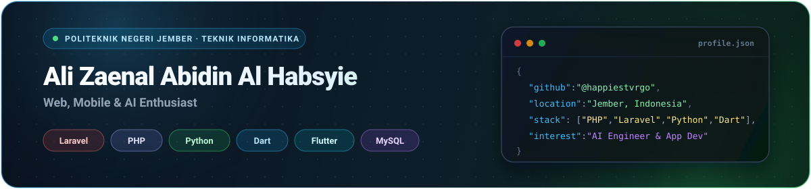

  Mahasiswa <strong>Teknik Informatika</strong> di <strong>Politeknik Negeri Jember</strong> (Jember, Indonesia). 
  Fokus pada pengembangan <strong>Web (Laravel &amp; REST API)</strong>, pemrograman <strong>Java</strong>, dan <strong>Aplikasi Mobile (Flutter)</strong>.

  
  

---

### Tentang Saya

- Saat ini sedang menempuh studi di **Politeknik Negeri Jember** (Program Studi Teknik Informatika).
- Berpengalaman membangun aplikasi web dengan **Laravel (PHP)**, pemrograman **Java**, serta pengembangan aplikasi mobile menggunakan **Flutter (Dart)** dan database **MySQL**.
- Tertarik pada perancangan **REST API** serta integrasi web dengan **IoT (ESP32)** dan **Bot Telegram**.
- Terbuka untuk kolaborasi proyek, diskusi teknis, maupun kesempatan **magang / internship** di bidang Web, Backend, dan Mobile Development.

---

### Tech Stack

| Bidang | Teknologi |
| :--- | :--- |
| **Backend & Database** |  |
| **Mobile & Frontend** |  |
| **Tools & IoT** |  |

---

### Proyek Pilihan

<table>
  <tr>
    <td width="50%" valign="top">
      <h4><a href="https://github.com/happiestvrgo/Chilivision-Semester5">ChiliVision — Smart Crop Monitoring</a></h4>
      

        Sistem monitoring dan pengendalian penyakit tanaman cabai berbasis <strong>Laravel 13</strong>, <strong>TiDB Cloud</strong>, <strong>YOLOv8n &amp; CNN (ONNX)</strong>, <strong>Chatbot Gemini AI</strong>, <strong>Bot Telegram 2 arah</strong>, serta <strong>IoT ESP32</strong>.
      

      

        <strong>Peran:</strong> Backend Engineer (REST API, skema database, integrasi chatbot, Telegram &amp; scheduler otomatis)
      

    </td>
    <td width="50%" valign="top">
      <h4><a href="https://github.com/happiestvrgo/Footwear-Fusion_Mobile">Footwear Fusion Mobile</a></h4>
      

        Aplikasi mobile berbasis <strong>Flutter</strong> &amp; <strong>Dart</strong> yang dikembangkan sebagai proyek pengembangan aplikasi perangkat bergerak.
      

      

        <strong>Stack:</strong> Flutter, Dart, REST API
      

    </td>
  </tr>
</table>

---

### Aktivitas GitHub

  
  

 

  Politeknik Negeri Jember · Jember, Indonesia

